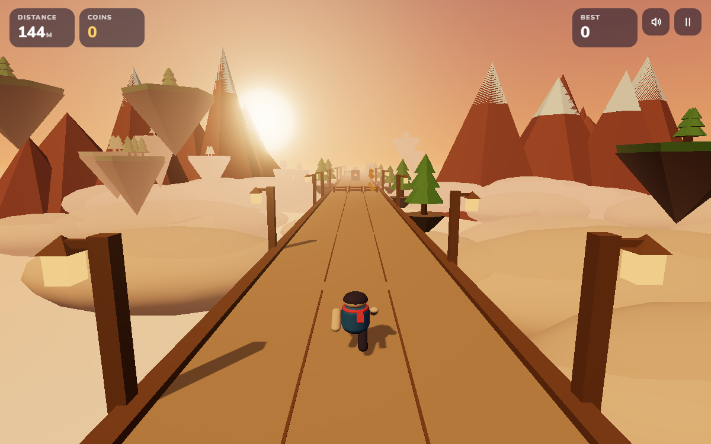
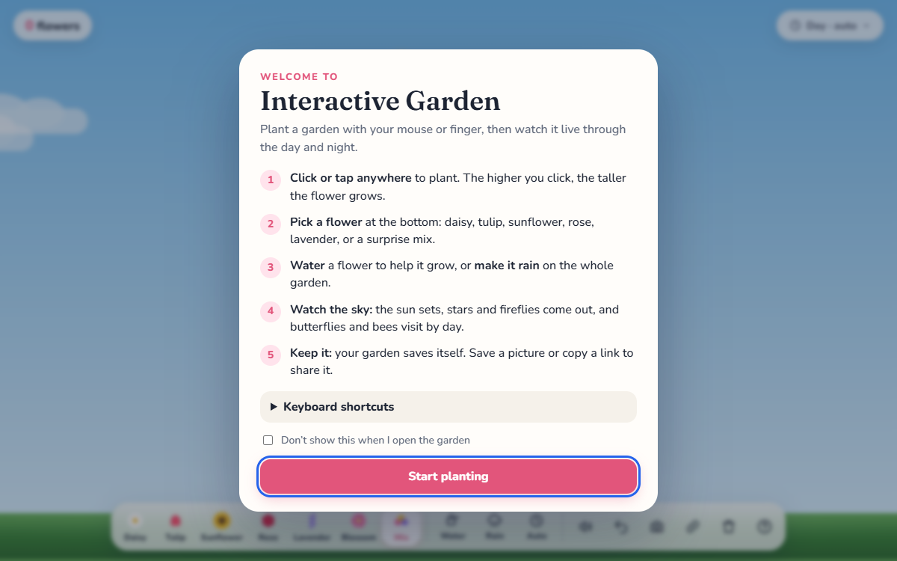
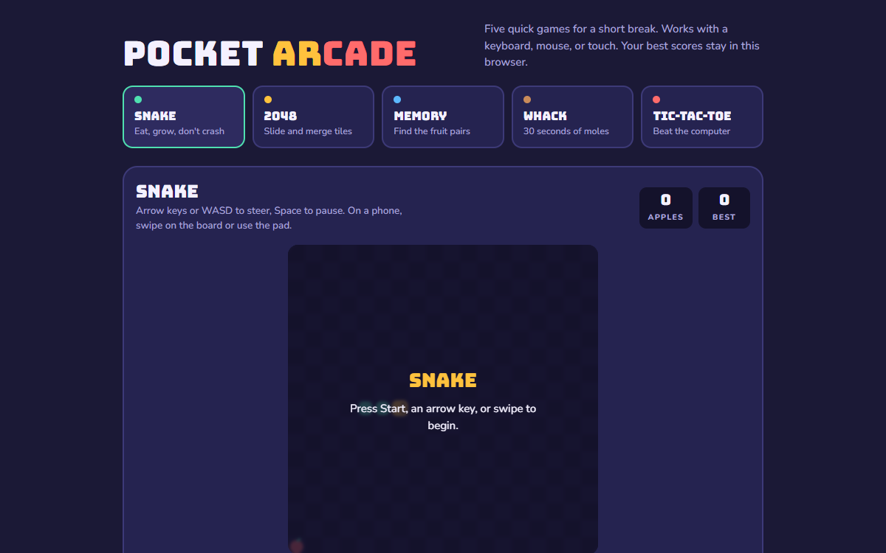
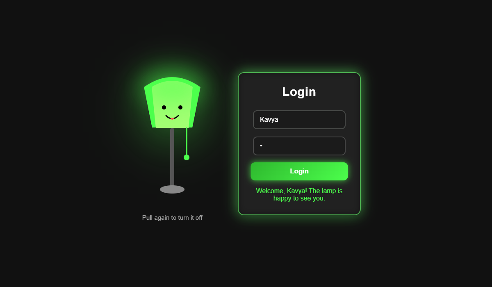

# Fun Web Projects


A collection of small creative web projects where I experiment with animation, 3D, games and playful UI ideas. Most are plain HTML, CSS and JavaScript with no build step: open `index.html` and they run.

**Play them live:** https://kc-2705.github.io/fun-web-programming/

| Project | What it is | Built with |
| --- | --- | --- |
| [Lantern Trail](LanternTrail/) · [play](https://kc-2705.github.io/fun-web-programming/LanternTrail/) | 3D endless runner across floating islands, with three biomes, coins, jumps, slides and swipe controls | three.js, Web Audio |
| [Interactive Garden](FlowerGarden/) · [play](https://kc-2705.github.io/fun-web-programming/FlowerGarden/) | Plant flowers, water them and watch the garden live through day and night. Saves itself and can be shared by link | SVG, JavaScript, Web Audio |
| [Pocket Arcade](pocket-arcade/) · [play](https://kc-2705.github.io/fun-web-programming/pocket-arcade/) | Five quick games (Snake, 2048, Memory, Whack-a-mole, Tic-tac-toe) with keyboard, mouse and touch support | Canvas, JavaScript |
| [Lamp Login](lampLogin/) · [play](https://kc-2705.github.io/fun-web-programming/lampLogin/) | A sleepy lamp that wakes up and reveals a login form when you pull its cord | SVG, CSS transitions |
| [Neon Heart](NeonHeart/) · [play](https://kc-2705.github.io/fun-web-programming/NeonHeart/) | Glowing animated neon heart | Canvas, JavaScript |
| [Candle](Candle/) · [play](https://kc-2705.github.io/fun-web-programming/Candle/) | Flickering candle made with pure CSS | CSS animations |
| [Merry Christmas](MerryChristmas/) · [play](https://kc-2705.github.io/fun-web-programming/MerryChristmas/) | Animated Christmas tree greeting | GSAP, SVG |
| [Love Letter](LoveLetter/loveletter/) | A small React app with a secret-code love letter, gallery, notes and songs | React |

## Screenshots

| Lantern Trail | Interactive Garden |
| --- | --- |
|  |  |
| **Pocket Arcade** | **Lamp Login** |
|  |  |

## Run locally

For the HTML projects, open the folder's `index.html` in a browser.

For Love Letter:

```bash
cd LoveLetter/loveletter
npm install
npm start
```
